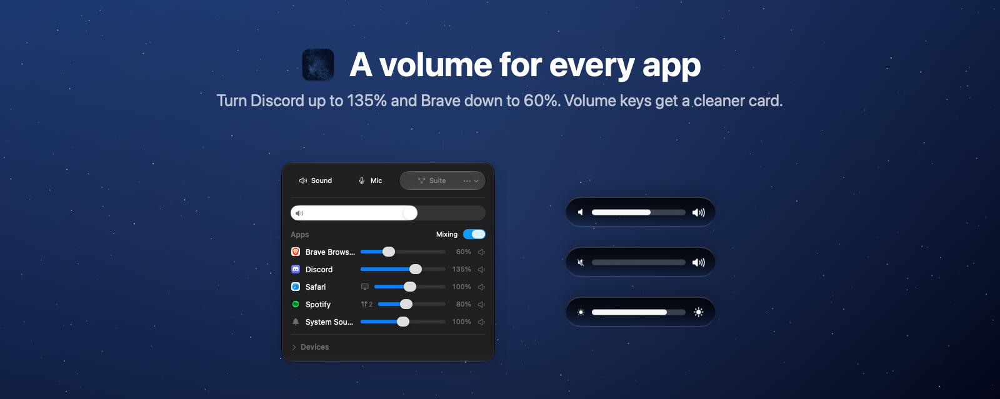
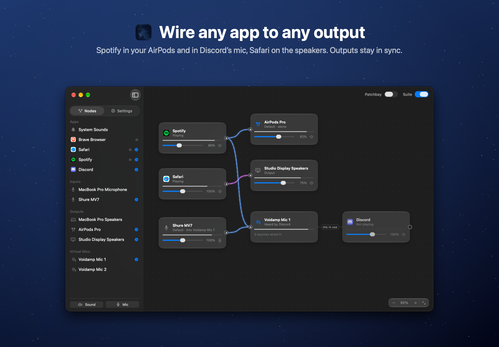

# Voidamp

A small menu bar mixer for your apps, speakers and microphones.





## Install

macOS 14.2+ · Apple silicon

1. [Download Voidamp](https://github.com/lumen-xx/voidamp-releases/releases/latest), unzip and move **Voidamp.app** to **Applications**.
2. Open it. If macOS blocks it, go to **System Settings → Privacy & Security → Open Anyway**, or run:

```sh
xattr -dr com.apple.quarantine /Applications/Voidamp.app
```

Voidamp is not notarized yet. Only run this for Voidamp downloaded here.

## Use

- Click the sound icon in the menu bar and allow system audio access when asked.
- Set each app's volume from 0–200%. Click its percentage to go back to 100%.
- Pick output and input devices, set their volume, mute sound or microphones, and rename devices with a right-click.
- Save device, level and wiring setups as profiles under **More → Profiles**.
- Click **Suite** to wire apps and microphones to any output in a node editor, for example Spotify to headphones and Safari to speakers. ⌘Z undoes changes on the board.
- Add **virtual mics** in the Suite: pick “Voidamp Mic 1” in Discord or any app, then wire your microphones (or an app) into it. Voidamp asks before quitting while an app listens to one.
- Volume and brightness keys show Voidamp's own overlay. Hover over it to drag the level. Allow Accessibility when asked.
- Right-click the menu bar icon for **More**: the Suite, Settings, Profiles, updates and Quit. **Settings** has System Sounds, Start at Login and the overlay switch.

Updates: **More → Check for Updates…**

The source repository is private.
